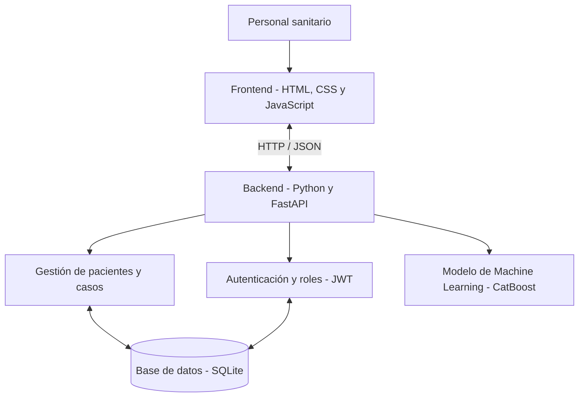
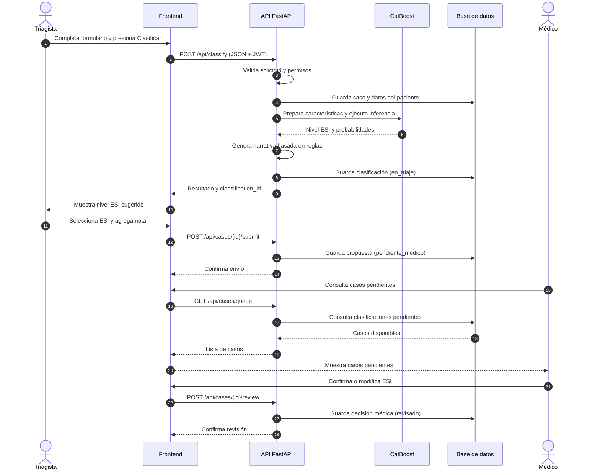
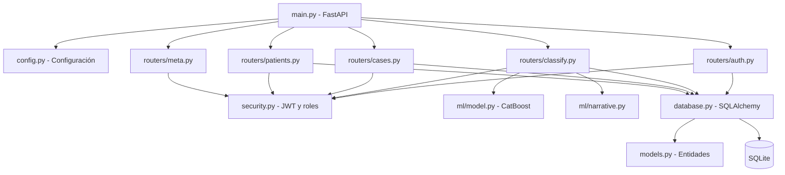
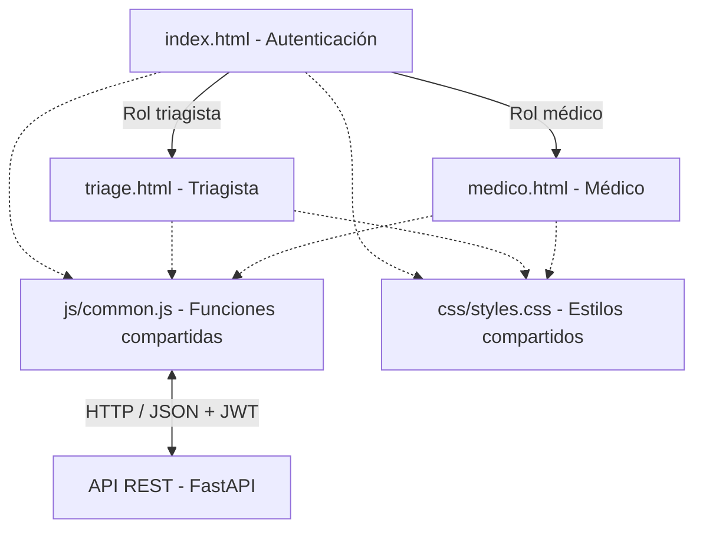
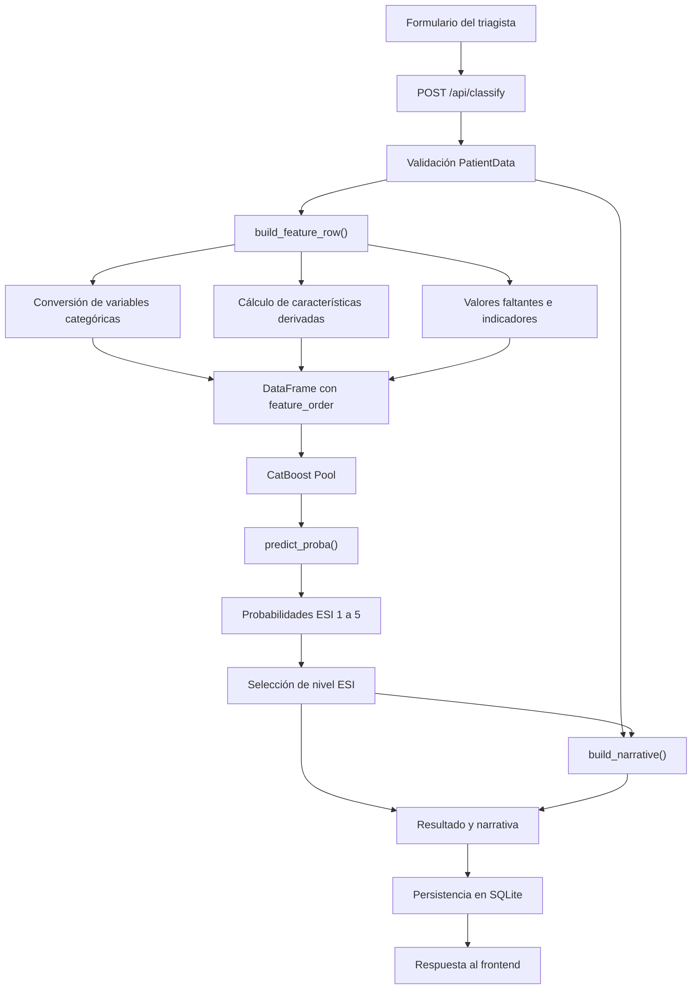
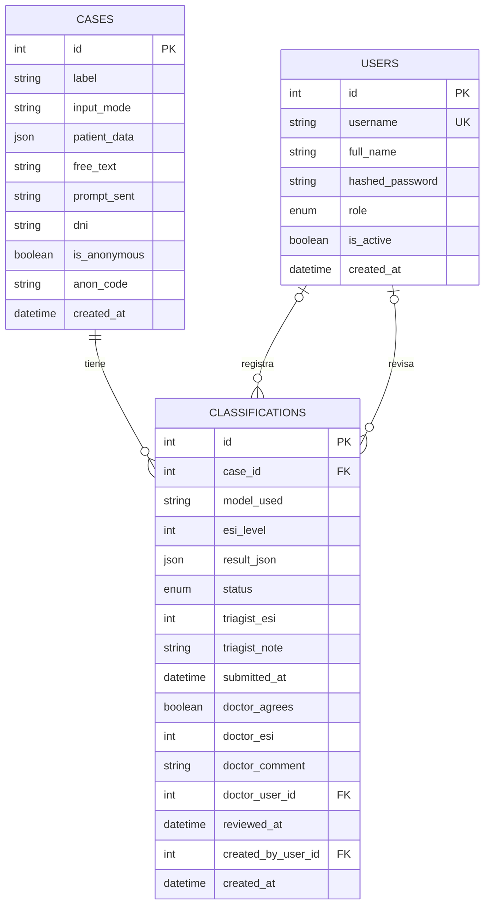

# Arquitectura Técnica del Sistema S.A.T.

**Sistema Automático de Triaje — TriageAI**

**Issue:** #24 — Documentar arquitectura de S.A.T.
**Estado:** En desarrollo
**Repositorio:** S-A-T-Sistema-Automatico-de-Triaje/SAT

## 1. Introducción

El Sistema Automático de Triaje (SAT) es una aplicación de apoyo a la clasificación inicial de pacientes, basada en la escala Emergency Severity Index (ESI), que establece cinco niveles de prioridad.

El sistema integra una interfaz web para el personal sanitario, una API desarrollada con FastAPI, un modelo de Machine Learning basado en CatBoost y una base de datos relacional.

Su arquitectura está diseñada para ejecutarse localmente dentro de la infraestructura de una institución sanitaria, sin depender de servicios externos para realizar la inferencia.

El modelo genera una clasificación sugerida que posteriormente puede ser evaluada por el personal de triaje y revisada por un médico.

## 2. Objetivo de la documentación

Describir la estructura técnica del SAT, sus componentes, responsabilidades, dependencias y mecanismos de comunicación.

Se documentarán:

- Arquitectura general del sistema.
- Organización del frontend.
- Arquitectura del backend y sus módulos.
- Integración del modelo CatBoost.
- Persistencia y relaciones de datos.
- Autenticación y autorización por roles.
- Flujo de información entre triagista, modelo y médico.
- Despliegue local y configuración.
- Limitaciones técnicas y consideraciones de seguridad.

## 3. Arquitectura general

El SAT utiliza una arquitectura cliente-servidor con separación entre presentación, lógica de aplicación, inferencia y persistencia.

### 3.1 Componentes principales

**Frontend:** aplicación web desarrollada con HTML, CSS y JavaScript. Proporciona las interfaces de autenticación, evaluación de pacientes, clasificación y revisión médica.

**Backend:** API REST desarrollada con Python y FastAPI. Centraliza la autenticación, las reglas de acceso, el procesamiento de solicitudes, la gestión de pacientes y la persistencia.

**Modelo de Machine Learning:** clasificador CatBoost ejecutado localmente. Procesa características del paciente y devuelve una propuesta de nivel ESI junto con probabilidades de clasificación.

**Base de datos:** persistencia relacional mediante SQLAlchemy, con SQLite como configuración local documentada.

### 3.2 Comunicación

El frontend utiliza solicitudes HTTP con datos JSON para comunicarse con la API del backend.

Los endpoints protegidos requieren autenticación mediante tokens JWT.

El backend procesa los datos clínicos, construye las características necesarias para el modelo, realiza la inferencia y guarda los resultados.

El personal sanitario puede consultar los casos almacenados y continuar el proceso de evaluación mediante los endpoints correspondientes.

### 3.3 Principio de supervisión humana

El sistema distingue entre tres decisiones:

1. Nivel ESI sugerido por el modelo.
2. Nivel ESI propuesto por el triagista.
3. Nivel ESI final establecido por el médico.

Estas decisiones se almacenan para mantener la trazabilidad del proceso de clasificación.

El resultado del modelo constituye una recomendación de apoyo y no reemplaza la evaluación clínica profesional.




## 4. Flujo de clasificación y revisión médica

El proceso de triaje comienza cuando un usuario con rol de
triagista registra la información de un paciente.

El backend procesa los datos, ejecuta el modelo CatBoost y
almacena la clasificación generada.

Posteriormente, el triagista revisa la sugerencia y propone
un nivel ESI al médico, quien puede confirmarlo o modificarlo.

### 4.1 Diagrama de secuencia



### 4.2 Estados de una clasificación

El sistema utiliza tres estados principales:

- **en_triaje:** el modelo clasificó al paciente,
  pero el triagista todavía no envió el caso.
- **pendiente_medico:** el triagista propuso su nivel
  ESI y envió el caso a revisión.
- **revisado:** el médico confirmó o modificó el
  nivel ESI y registró su decisión.

Estos estados permiten seguir el progreso de cada caso
y conservar la trazabilidad de las decisiones.

## 5. Arquitectura del Backend

El backend del Sistema Automático de Triaje está desarrollado en Python utilizando FastAPI. Su responsabilidad principal es coordinar la autenticación de usuarios, la recepción y validación de solicitudes, el procesamiento de datos clínicos, la inferencia del modelo CatBoost y la persistencia de resultados.

La aplicación se organiza en módulos con responsabilidades diferenciadas, utilizando routers de FastAPI para separar los distintos servicios.

### 5.1 Organización de módulos

```text
backend/
└── app/
    ├── main.py
    ├── config.py
    ├── database.py
    ├── models.py
    ├── schemas.py
    ├── security.py
    ├── prompts.py
    ├── routers/
    │   ├── auth.py
    │   ├── cases.py
    │   ├── classify.py
    │   ├── meta.py
    │   └── patients.py
    └── ml/
        ├── model.py
        ├── narrative.py
        └── artifacts/
            └── triage_catboost_model.joblib
```

### 5.2 Responsabilidad de los módulos principales

| Módulo | Responsabilidad |
|---|---|
| `main.py` | Inicialización de FastAPI, configuración de CORS, registro de routers y creación de tablas y usuarios iniciales. |
| `config.py` | Configuración centralizada de la aplicación mediante Pydantic Settings y variables de entorno. |
| `database.py` | Creación del motor SQLAlchemy y administración de sesiones de base de datos. |
| `models.py` | Definición de las entidades persistentes, relaciones y estados de clasificación. |
| `schemas.py` | Definición de los esquemas de datos utilizados para solicitudes y respuestas mediante Pydantic. |
| `security.py` | Autenticación, hash de contraseñas, tokens JWT y autorización por roles. |
| `prompts.py` | Construcción de representaciones textuales del formulario para registro y trazabilidad. |

### 5.3 Routers de la API

Los routers agrupan los endpoints según la funcionalidad que administran.

| Router | Prefijo | Función |
|---|---|---|
| `auth.py` | `/api/auth` | Inicio de sesión y administración de usuarios. |
| `classify.py` | `/api` | Clasificación de pacientes mediante el modelo. |
| `cases.py` | `/api/cases` | Gestión, consulta, envío y revisión de casos. |
| `meta.py` | `/api/meta` | Opciones y categorías válidas del formulario. |
| `patients.py` | `/api/patients` | Búsqueda por DNI, fichas e historial de pacientes. |

Esta separación facilita el mantenimiento y permite incorporar nuevas funcionalidades sin concentrar toda la lógica en un único archivo.

### 5.4 Inicialización del sistema

El archivo `main.py` crea la instancia principal de FastAPI y registra los routers.

Durante el arranque:

1. Configura los orígenes permitidos mediante CORS.
2. Crea las tablas de base de datos que todavía no existan.
3. Comprueba si es necesario agregar la columna `dni` a la tabla de casos existente.
4. Crea los usuarios iniciales faltantes.
5. Habilita el endpoint `/api/health` para verificar el estado del servicio.

La inicialización de tablas utiliza `Base.metadata.create_all()`. La migración existente para el DNI se realiza mediante SQL.

Actualmente, el proyecto no utiliza un sistema general de migraciones como Alembic.

### 5.5 Autenticación y autorización

SAT utiliza autenticación mediante JWT y contraseñas verificadas mediante hashes bcrypt.

El procedimiento de autenticación consiste en:

1. El usuario introduce sus credenciales.
2. El frontend envía una solicitud a `POST /api/auth/login`.
3. El backend verifica el usuario y su contraseña.
4. Si las credenciales son válidas, genera un token JWT.
5. El frontend utiliza el token en las solicitudes posteriores mediante el encabezado `Authorization: Bearer`.
6. Los endpoints protegidos verifican la identidad y los permisos del usuario.

El archivo `security.py` contiene las funciones `authenticate_user()`, `create_access_token()`, `get_current_user()` y `require_roles()`.

Los roles declarados incluyen triagista, médico de guardia, administrador, jefe de enfermería y auditor clínico. No todos cuentan actualmente con una interfaz propia.

### 5.6 Procesamiento de una clasificación

El endpoint `POST /api/classify`, implementado en `routers/classify.py`, recibe la información estructurada del paciente.

Su flujo es el siguiente:

1. Comprueba los permisos del usuario.
2. Verifica que la solicitud contenga información del paciente y motivo de consulta.
3. Procesa la identificación y el DNI opcional.
4. Crea y almacena el caso clínico.
5. Invoca `classify_features()` del módulo de Machine Learning.
6. Genera información complementaria mediante `build_narrative()`.
7. Almacena el resultado en la entidad `Classification`.
8. Devuelve el identificador del caso, el nivel ESI sugerido y los resultados correspondientes.

La clasificación queda inicialmente en estado `en_triaje`.

**Consideración técnica:** el caso se guarda antes de ejecutar la inferencia. Si el modelo produce un error, puede permanecer un registro de caso sin clasificación asociada. Este comportamiento debe considerarse en futuras mejoras de manejo de transacciones.

### 5.7 Gestión de casos y revisión médica

El router `cases.py` administra el ciclo posterior a la clasificación.

El triagista puede consultar sus casos y enviar una propuesta ESI al médico. El médico accede a la cola de pendientes y puede confirmar o modificar el nivel propuesto, registrando sus observaciones.

Los estados principales son:

- `en_triaje`: clasificación generada, pendiente de envío.
- `pendiente_medico`: caso enviado para revisión médica.
- `revisado`: caso evaluado por el médico.

La entidad `Classification` conserva el nivel ESI del modelo, el propuesto por el triagista y el establecido por el médico.

### 5.8 Gestión del historial de pacientes

El módulo `patients.py` incorpora consultas por DNI, búsqueda de pacientes, autocompletado e historial de visitas.

El DNI se normaliza para utilizar únicamente dígitos y sirve como identificador de vinculación entre visitas.

La búsqueda por nombre permite localizar registros, pero no fusiona automáticamente historias clínicas. Los casos anónimos no almacenan DNI.

La información del historial se construye a partir de los casos y clasificaciones existentes, sin requerir una entidad independiente de paciente.

### 5.9 Persistencia

La conexión a la base de datos se centraliza en `database.py`.

SQLAlchemy proporciona el motor de conexión, las sesiones y la base declarativa utilizada por los modelos.

La configuración local utiliza SQLite, aunque la URL de conexión es configurable mediante `DATABASE_URL`.

Las entidades principales son:

- `User`: usuarios y roles.
- `Case`: información registrada para una consulta.
- `Classification`: resultados del modelo y decisiones humanas.

Las relaciones detalladas entre estas entidades se presentan en la sección dedicada al modelo de datos.

### 5.10 Consideraciones técnicas

La arquitectura actual presenta algunas características relevantes:

- El backend y el modelo de Machine Learning se ejecutan localmente.
- CatBoost no requiere un servicio de inferencia externo.
- El sistema utiliza control de acceso basado en roles.
- Los resultados de clasificación y las decisiones humanas se almacenan para trazabilidad.
- La base de datos SQLite es adecuada para desarrollo y pruebas locales; un despliegue con múltiples puestos concurrentes requeriría evaluar una solución de persistencia apropiada.
- Las validaciones del frontend no reemplazan la validación del backend ni las reglas clínicas.
- Las credenciales iniciales de desarrollo y las claves configuradas por defecto deben reemplazarse antes de cualquier uso real.



## 6. Arquitectura del Frontend

El frontend del Sistema Automático de Triaje (SAT) está desarrollado mediante HTML5, CSS3 y JavaScript nativo.

Su arquitectura utiliza páginas independientes según el rol del usuario, acompañadas de archivos compartidos para estilos, autenticación, comunicación con la API y representación de información clínica.

El frontend actúa como capa de presentación e interacción. No ejecuta directamente el modelo CatBoost ni accede a la base de datos: estas operaciones son responsabilidad del backend.

### 6.1 Estructura de archivos

```text
Frontend/
├── index.html
├── triage.html
├── medico.html
├── css/
│   └── styles.css
└── js/
    └── common.js
```

### 6.2 Responsabilidad de los componentes

| Archivo | Responsabilidad |
|---|---|
| `index.html` | Pantalla de autenticación y redirección según el rol. |
| `triage.html` | Registro de pacientes, evaluación clínica, clasificación ESI, consulta y envío de casos. |
| `medico.html` | Consulta de casos pendientes, revisión médica, búsqueda de pacientes e historial. |
| `css/styles.css` | Estilos compartidos, variables visuales, componentes y temas claro/oscuro. |
| `js/common.js` | Gestión de sesión, comunicación con la API y funciones compartidas de representación clínica. |

Cada página HTML contiene también lógica JavaScript y estilos específicos de su interfaz.

### 6.3 Pantalla de autenticación

El archivo `index.html` presenta los campos de usuario y contraseña.

La autenticación se realiza mediante la función `doLogin()` de `common.js`, que envía las credenciales a:

`POST /api/auth/login`

Cuando la autenticación es exitosa, el frontend recibe un token JWT y la información básica del usuario.

La función `homeFor()` determina la pantalla de destino según el rol:

- `medico_guardia`: `medico.html`.
- `triagista`: `triage.html`.

La función también utiliza `triage.html` como destino predeterminado para otros roles; esto no implica que todos ellos tengan una interfaz específica.

### 6.4 Interfaz del triagista

El archivo `triage.html` concentra las operaciones de evaluación inicial de pacientes.

El formulario de ingreso se organiza en cuatro etapas:

1. Identificación y motivo de consulta.
2. Evaluación clínica y signos vitales.
3. Antecedentes y comorbilidades.
4. Revisión de información y clasificación.

El formulario permite navegar entre etapas conservando los valores ingresados.

También incorpora validaciones de rangos numéricos, comprobaciones de coherencia entre valores relacionados, mensajes de error y confirmación antes de descartar datos.

La validación implementada en el navegador constituye una primera barrera frente a errores de ingreso, pero no reemplaza las comprobaciones del backend.

#### Gestión de casos

La interfaz dispone de un panel «Mis casos» que permite consultar las evaluaciones registradas.

Después de una clasificación exitosa, se abre el panel correspondiente y se presenta el resultado.

El triagista puede revisar la sugerencia del modelo, seleccionar un nivel ESI y agregar observaciones antes de enviar el caso al médico.

Entre las funciones relevantes se encuentran:

- `getPatientData()`: recopila los valores del formulario.
- `classify()`: solicita una clasificación al backend.
- `loadMine()`: recupera los casos del usuario.
- `openCase()`: obtiene la información de un caso.
- `sendToDoctor()`: envía la propuesta ESI para revisión.
- `showStep()`: controla la navegación entre etapas.

### 6.5 Interfaz del médico

El archivo `medico.html` proporciona las funcionalidades destinadas a la revisión de casos clínicos.

Permite consultar la cola de pacientes pendientes, abrir un caso, revisar la información registrada y comparar las decisiones del modelo y del triagista.

El médico puede confirmar el nivel ESI propuesto o modificarlo, incorporando observaciones.

También dispone de funciones de búsqueda por DNI o nombre, consulta del historial y visualización de pacientes revisados.

Entre sus funciones principales se encuentran:

- `loadQueue()`: obtiene los casos pendientes.
- `openCase()`: recupera un caso seleccionado.
- `renderDetail()`: representa la información de la evaluación.
- `loadHistory()`: obtiene visitas anteriores.
- `openRecord()`: consulta la ficha de un paciente.
- `sendReview()`: registra la decisión médica.

La revisión se envía mediante:

`POST /api/cases/{id}/review`

### 6.6 Funcionalidades compartidas

El archivo `js/common.js` centraliza las funciones utilizadas por las distintas pantallas.

Sus principales responsabilidades incluyen:

**Autenticación y sesión**

- Recuperación del token mediante `getToken()`.
- Consulta de información del usuario mediante `getUser()`.
- Control de acceso visual mediante `requireRole()`.
- Cierre de sesión mediante `doLogout()`.

**Comunicación con el backend**

La función `api()` utiliza `fetch()` para realizar solicitudes HTTP.

Cuando corresponde, incorpora el token JWT mediante el encabezado:

`Authorization: Bearer <token>`

También gestiona respuestas de error y situaciones de sesión expirada.

**Presentación**

Incluye funciones para mostrar niveles ESI, signos vitales, resúmenes clínicos, fechas, historiales y fichas de pacientes.

### 6.7 Estilos e interfaz visual

El archivo `css/styles.css` define variables CSS reutilizables para colores, tipografía, superficies, bordes y componentes.

El sistema dispone de temas claro y oscuro.

La interfaz también utiliza colores específicos para diferenciar los niveles ESI.

Las páginas contienen estilos adicionales para necesidades particulares de cada pantalla.

Se utilizan reglas de adaptación para distintas dimensiones de pantalla, aunque esto no constituye por sí mismo una garantía de accesibilidad o compatibilidad con todos los dispositivos.

### 6.8 Comunicación con el backend

El frontend se sirve localmente desde el puerto `8080`, mientras que la API FastAPI se ejecuta en el puerto `8000`.

La comunicación se realiza mediante HTTP, utilizando solicitudes JSON en las operaciones que requieren cuerpos estructurados.

Algunos endpoints utilizados son:

| Método | Endpoint | Función |
|---|---|---|
| POST | `/api/auth/login` | Autenticación |
| GET | `/api/meta/form-options` | Opciones del formulario |
| POST | `/api/classify` | Clasificación ESI |
| GET | `/api/cases/mine` | Casos del triagista |
| GET | `/api/cases/queue` | Cola de revisión médica |
| GET | `/api/cases/{id}` | Detalle del caso |
| POST | `/api/cases/{id}/submit` | Envío al médico |
| POST | `/api/cases/{id}/review` | Revisión médica |
| GET | `/api/patients/record/{dni}` | Ficha e historial de paciente |

El backend es el responsable de aplicar las verificaciones de autenticación y autorización.

**Configuración de entornos:** durante la fase de desarrollo y pruebas, el frontend utiliza `http://localhost:8000` para conectarse al backend FastAPI. Esta configuración es intencional y permite ejecutar el sistema localmente.

En un eventual despliegue institucional, la dirección de conexión deberá adaptarse a la infraestructura del servidor, preferentemente mediante una configuración específica por entorno o un proxy inverso, evitando modificar manualmente el código fuente para cada instalación.

### 6.9 Consideraciones de seguridad

El frontend utiliza `localStorage` para conservar el token y la información básica de la sesión.

Esta decisión facilita la gestión de sesión desde JavaScript, aunque requiere medidas adecuadas frente a vulnerabilidades como Cross-Site Scripting (XSS).

El sistema también incorpora funciones de escape de contenido al generar determinadas representaciones HTML.

No obstante, estas funciones no reemplazan una revisión integral de seguridad.

El control de acceso visual mediante `requireRole()` tampoco sustituye los permisos implementados en FastAPI.

### 6.10 Limitaciones y evolución

La implementación actual es una aplicación multipágina basada en JavaScript nativo.

Su estructura permite un desarrollo relativamente sencillo, aunque parte de la lógica específica de cada pantalla permanece integrada en los archivos HTML.

Entre las posibles mejoras de mantenimiento se encuentran la modularización progresiva del JavaScript, la incorporación de pruebas automatizadas de interfaz y el fortalecimiento de los controles de seguridad del lado del cliente.

Estas mejoras se consideran posibilidades de evolución, no funcionalidades actualmente implementadas.


### 6.11 Diagrama de componentes del Frontend



Las flechas continuas representan la navegación según el rol.

Las flechas discontinuas representan dependencias de recursos compartidos y comunicación funcional.

## 7. Arquitectura del modelo de Machine Learning

El Sistema Automático de Triaje incorpora un modelo de aprendizaje supervisado basado en CatBoost para estimar el nivel de prioridad ESI de un paciente.

El modelo utiliza información estructurada ingresada por el triagista y genera una distribución de probabilidades correspondiente a los cinco niveles ESI.

La inferencia se ejecuta localmente dentro del backend Python. No requiere conectarse a un servicio externo ni utilizar un modelo de lenguaje para realizar la clasificación.

### 7.1 Componentes del módulo de Machine Learning

El módulo principal se encuentra en:

`backend/app/ml/model.py`

Este módulo se encarga de cargar el modelo entrenado, transformar los datos del paciente en características compatibles con el entrenamiento y ejecutar la predicción.

El archivo:

`backend/app/ml/artifacts/triage_catboost_model.joblib`

contiene un paquete serializado con los siguientes elementos:

| Elemento | Descripción |
|---|---|
| `model` | Clasificador CatBoost previamente entrenado |
| `cat_features` | Identificación de las características categóricas |
| `feature_order` | Orden de columnas esperado durante la inferencia |

El módulo `ml/narrative.py` complementa el resultado mediante reglas clínicas programadas.

### 7.2 Carga del modelo

La función `get_bundle()` utiliza `joblib.load()` para recuperar el paquete del modelo.

La carga está protegida mediante `lru_cache(maxsize=1)`, evitando deserializar repetidamente el archivo durante las solicitudes posteriores del mismo proceso.

La función verifica la presencia de las claves `model`, `cat_features` y `feature_order`.

Si el archivo no existe o tiene una estructura incompatible, la aplicación genera un error.

### 7.3 Preparación de características

La función `build_feature_row()` transforma la información recibida mediante el esquema `PatientData` en un DataFrame de pandas.

Las características utilizadas se construyen dinámicamente según el orden requerido por el modelo entrenado.

El procesamiento contempla:

**Características demográficas**

Edad, grupo etario y sexo.

**Signos vitales**

Frecuencia cardíaca, presión arterial, frecuencia respiratoria, saturación de oxígeno y temperatura corporal.

**Características clínicas**

Escala de Glasgow, intensidad y localización del dolor, estado mental, sistema asociado al motivo de consulta y comorbilidades.

**Variables derivadas**

Presión arterial media, presión de pulso, índice de shock, índice de masa corporal y una puntuación inspirada en NEWS2.

**Variables contextuales**

Hora, mes, día, turno y sede de atención, entre otras.

Algunas variables administrativas todavía no se capturan mediante el formulario. Para ellas se utilizan valores predeterminados, como `unknown` o cero, según corresponda.

### 7.4 Tratamiento de variables categóricas

CatBoost permite trabajar directamente con características categóricas sin requerir que el código de inferencia aplique un `LabelEncoder`.

Los valores utilizados por el formulario se transforman cuando es necesario para respetar las categorías esperadas.

Por ejemplo:

| Valor del formulario | Valor enviado al modelo |
|---|---|
| Masculino | `M` |
| Femenino | `F` |
| Otro | `Other` |
| Alerta | `alert` |
| Confundido | `confused` |
| Somnoliento | `drowsy` |

Las características categóricas se incorporan al objeto `Pool` utilizado para la predicción.

### 7.5 Tratamiento de datos faltantes

Para las características numéricas, el sistema representa los valores no informados mediante `NaN`, aprovechando la capacidad de CatBoost para procesar valores faltantes.

También genera indicadores de ausencia para aquellas columnas cuyo nombre termina en `_missing`.

Esta estrategia conserva información sobre qué datos clínicos estaban disponibles al momento de realizar la clasificación.

### 7.6 Ejecución de la inferencia

La función `classify_features()` ejecuta el siguiente procedimiento:

1. Recupera el modelo previamente cargado.
2. Construye la fila de características del paciente.
3. Genera un objeto `Pool` de CatBoost.
4. Ejecuta `predict_proba()`.
5. Obtiene las probabilidades de cada nivel ESI.
6. Selecciona el nivel asociado con la mayor probabilidad.
7. Devuelve el nivel, su etiqueta y el valor de confianza.

La implementación actual calcula el nivel mediante:

`esi_level = argmax(probabilidades) + 1`

El resultado incluye:

- `esi_level`: nivel ESI estimado.
- `esi_label`: descripción del nivel.
- `confidence`: mayor probabilidad predicha.
- `proba_by_class`: probabilidades de los cinco niveles.

El valor de confianza representa una salida del modelo, no una garantía de exactitud clínica ni una probabilidad necesariamente calibrada.

### 7.7 Generación de narrativa clínica

El módulo `ml/narrative.py` utiliza la función `build_narrative()` para construir información complementaria a partir de reglas programadas.

Entre sus resultados se incluyen:

- Motivo principal de consulta.
- Descripción general del nivel asignado.
- Señales de alerta basadas en determinados umbrales de signos vitales.
- Acciones orientativas asociadas al nivel ESI.

Esta narrativa no constituye una explicación causal del funcionamiento interno de CatBoost.

Tampoco se genera mediante un LLM ni equivale a una interpretación SHAP.

Las referencias residuales a XGBoost presentes en el módulo deben actualizarse para mantener consistencia con el clasificador actualmente utilizado.

### 7.8 Integración con FastAPI

El endpoint `POST /api/classify` coordina la ejecución del módulo de Machine Learning.

El backend recibe y valida los datos estructurados, guarda el caso clínico, llama a `classify_features()`, genera la narrativa complementaria y registra la clasificación.

El modelo devuelve una sugerencia ESI, pero no establece por sí mismo la decisión clínica final.

La evaluación continúa con la propuesta del triagista y la revisión del médico.

### 7.9 Limitaciones técnicas y clínicas

La implementación actual presenta consideraciones relevantes:

- Algunas características contextuales utilizan valores predeterminados en lugar de información real del paciente.
- La puntuación denominada NEWS2 se calcula bajo supuestos simplificados, por lo que no debe interpretarse automáticamente como una implementación clínica completa de la escala.
- La narrativa basada en reglas no explica qué características determinaron efectivamente cada predicción del modelo.
- El código de inferencia no acredita por sí solo la validación clínica, la calibración de probabilidades ni el rendimiento del modelo en pacientes reales.
- El uso del sistema en un entorno asistencial requeriría evaluación clínica, pruebas de seguridad, supervisión profesional y controles adecuados al contexto de implementación.

Estas observaciones describen las limitaciones verificadas o las validaciones pendientes; no constituyen funcionalidades ya implementadas.

### 7.10 Supervisión humana

SAT conserva separadas las decisiones del modelo, del triagista y del médico.

La predicción de CatBoost funciona como herramienta de apoyo a la evaluación inicial, mientras que el personal sanitario mantiene la responsabilidad de las decisiones clínicas.

La arquitectura permite registrar diferencias entre la sugerencia automática y las decisiones humanas, favoreciendo la trazabilidad y el análisis posterior del sistema.


### 7.11 Diagrama del proceso de inferencia



El diagrama representa las etapas lógicas del procesamiento. La generación de características se realiza dentro de la función `build_feature_row()`, mientras que la narrativa se construye por separado a partir de los datos clínicos y del nivel ESI estimado.

## 8. Modelo de datos y persistencia

El Sistema Automático de Triaje utiliza una base de datos relacional administrada mediante SQLAlchemy, el ORM utilizado por el backend FastAPI.

En el entorno de desarrollo, la base de datos predeterminada es SQLite, configurada mediante la variable `DATABASE_URL`.

Las entidades persistentes se definen en `backend/app/models.py`.

### 8.1 Entidades principales

El modelo de datos se organiza en tres tablas: `users`, `cases` y `classifications`.

#### Tabla `users`

Almacena las cuentas de acceso al sistema.

| Campo | Descripción |
|---|---|
| `id` | Identificador único del usuario (PK) |
| `username` | Nombre de usuario, único |
| `full_name` | Nombre completo |
| `hashed_password` | Contraseña almacenada mediante hash |
| `role` | Rol asignado |
| `is_active` | Estado de la cuenta |
| `created_at` | Fecha de creación |

#### Tabla `cases`

Representa una consulta o episodio clínico registrado.

| Campo | Descripción |
|---|---|
| `id` | Identificador único del caso (PK) |
| `label` | Nombre, código anónimo o descripción |
| `input_mode` | Modo de ingreso |
| `patient_data` | Datos clínicos estructurados en JSON |
| `free_text` | Campo para texto libre |
| `prompt_sent` | Representación textual registrada |
| `dni` | DNI opcional para vincular visitas |
| `is_anonymous` | Indica si el caso es anónimo |
| `anon_code` | Código de identificación anónima |
| `created_at` | Fecha de creación |

Los casos anónimos no almacenan DNI mientras mantienen esa condición.

#### Tabla `classifications`

Almacena las clasificaciones y decisiones efectuadas durante el proceso de triaje.

| Campo | Descripción |
|---|---|
| `id` | Identificador de clasificación (PK) |
| `case_id` | Caso asociado (FK) |
| `model_used` | Identificador del modelo utilizado |
| `esi_level` | Nivel ESI estimado por el modelo |
| `result_json` | Resultado completo en formato JSON |
| `status` | Estado del proceso de revisión |
| `triagist_esi` | Nivel propuesto por el triagista |
| `triagist_note` | Observaciones del triagista |
| `submitted_at` | Fecha de envío al médico |
| `doctor_agrees` | Indica si el médico confirma la propuesta |
| `doctor_esi` | Nivel ESI final registrado por el médico |
| `doctor_comment` | Comentario médico |
| `doctor_user_id` | Usuario que realizó la revisión (FK) |
| `reviewed_at` | Fecha de revisión |
| `created_by_user_id` | Usuario que generó la clasificación (FK) |
| `created_at` | Fecha de creación |

### 8.2 Relaciones entre entidades

Las relaciones se definen mediante claves foráneas y relaciones ORM.

**User → Classification**

Un usuario puede generar múltiples clasificaciones.

La clave `created_by_user_id` identifica al usuario que registró la clasificación.

Adicionalmente, `doctor_user_id` identifica al profesional que realizó la revisión médica.

Ambas referencias pueden contener valores nulos según la definición actual del modelo.

**Case → Classification**

Un caso puede estar relacionado con múltiples clasificaciones.

Cada clasificación debe pertenecer a un caso existente mediante `case_id`.

Aunque el flujo habitual genera una clasificación al registrar un caso, el modelo de datos admite una relación uno a muchos.

### 8.3 Identificación de pacientes por DNI

El sistema no implementa actualmente una tabla independiente de pacientes.

La asociación de visitas se realiza consultando los casos que comparten el mismo DNI normalizado.

El módulo `routers/patients.py` utiliza este criterio para construir fichas, historiales y resúmenes clínicos.

Las búsquedas por nombre sirven para localizar registros, pero no establecen automáticamente que dos casos pertenezcan a una misma persona.

Este mecanismo evita asociar historiales únicamente por coincidencia de nombres.

### 8.4 Almacenamiento de datos clínicos

El campo `patient_data` almacena un objeto JSON que conserva la información ingresada al momento de registrar el caso.

De manera similar, `result_json` almacena el resultado de la clasificación, incluyendo su información clínica complementaria.

Esta solución permite conservar estructuras complejas sin crear una columna independiente para cada dato.

Como contrapartida, algunas consultas analíticas y validaciones estructurales pueden resultar más complejas que en un modelo completamente normalizado.

### 8.5 Estados y trazabilidad

La tabla `classifications` utiliza los siguientes estados:

- `en_triaje`
- `pendiente_medico`
- `revisado`

Los campos de fechas, usuarios y decisiones permiten reconstruir los principales acontecimientos del proceso.

El sistema conserva las propuestas ESI de los distintos participantes, aunque no implementa necesariamente un registro inmutable de cada modificación.

### 8.6 Inicialización y migraciones

En el arranque del backend, SQLAlchemy ejecuta `Base.metadata.create_all()` para crear las tablas que no existan.

También se implementa una migración específica para incorporar el campo `dni` a bases existentes.

Actualmente, el proyecto no utiliza Alembic como mecanismo general de control de versiones del esquema.

### 8.7 Consideraciones para producción

La configuración SQLite resulta útil para desarrollo y pruebas.

Para un despliegue con múltiples puestos de atención, concurrencia significativa y requisitos institucionales, será necesario evaluar la estrategia de persistencia, copias de seguridad, recuperación, control de acceso y protección de información clínica.

La eventual migración a otro motor, como PostgreSQL, debe tratarse como una decisión de despliegue futura y no como parte ya implementada del sistema.


### 8.8 Diagrama entidad-relación



**Nota:** las dos relaciones desde `USERS` representan claves foráneas distintas: `created_by_user_id` y `doctor_user_id`. El DNI no se representa como clave foránea porque actualmente no referencia otra tabla.
